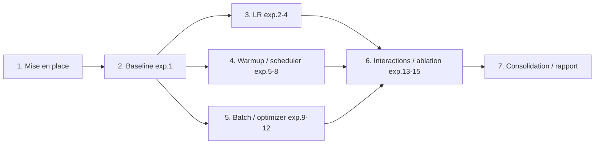

# Ordre de réalisation du projet

Ce document décrit l'**enchaînement des 7 étapes** du projet, avec les
**dépendances** entre étapes et les **critères de sortie** (definition of done).

Budget global : **15 entraînements maximum**, **< 10 minutes chacun**,
sur **Google Colab (GPU T4)**.

---

## 1. Vue d'ensemble

| # | Étape | Responsable | Dépend de | Livrable |
|---|---|---|---|---|
| 1 | Mise en place : dépôt, structure, `src/config.py`, environnement Colab | Oussama + Nada | — | dépôt public, `main` protégée, 4 branches |
| 2 | Dataset, nettoyage, baseline (exp. 1) | Nada | 1 | `exp_01_baseline` + métriques figées |
| 3 | Learning rate (exp. 2 → 4) | Nada | 2 | 3 lignes complètes dans le plan |
| 4 | Warmup et scheduler (exp. 5 → 8) | Fatima | 2 | 4 lignes complètes dans le plan |
| 5 | Batch size et optimizer + temps/mémoire GPU (exp. 9 → 12) | Aya | 2 | 4 lignes + tableau temps/mémoire |
| 6 | Interactions, ablation, meilleure combinaison (exp. 13 → 15) | Oussama | 3, 4, 5 | 3 lignes + choix argumenté |
| 7 | Consolidation, figures, analyse d'erreurs, rapport | Tous (pilote : Oussama) | 6 | rapport final + figures |

---

## 2. Détail des étapes

### Étape 1 — Mise en place (Oussama + Nada)

**Objectif** : disposer d'un dépôt unique, d'une configuration de référence et
d'un environnement Colab fonctionnel.

- Créer le dépôt public `transformer-hyperparam-study`.
- Vérifier la structure (`src/`, `notebooks/`, `experiments/`, `results/`, `docs/`).
- Valider l'import : `python -c "import src.config"`.
- Créer les 4 branches : `nada/baseline`, `fatima/warmup-scheduler`,
  `aya/batch-optimizer`, `oussama/evaluation`.
- Activer la protection de `main` (Pull Request obligatoire).

**Critères de sortie**

- [ ] `main` contient le commit initial.
- [ ] Les 4 branches existent sur le dépôt distant.
- [ ] Un run de test (1 step) passe sur Colab sans erreur d'environnement.

**Dépendances** : aucune. **Bloque** : tout le reste.

---

### Étape 2 — Dataset et baseline (Nada) — expérience 1

**Objectif** : figer les données et la référence à laquelle tout sera comparé.

- Charger IMDB via `datasets`, nettoyer avec Pandas (`src/data.py`).
- Vérifier les splits : 4 000 / 1 000 / 1 000, seed 42, aucune fuite train/test.
- Lancer la baseline : `python -m src.train --id 1 --owner Nada --name baseline`.
- Remplir la ligne 1 de `experiments/experiments_plan.csv`.

**Critères de sortie**

- [ ] `results/nada/exp_01_baseline/` contient `metrics.json`, `run_config.json`,
      `classification_report.txt`.
- [ ] Temps d'entraînement < 10 min (mesuré et noté).
- [ ] Métriques de la baseline publiées dans le canal d'équipe.

**Dépendances** : étape 1. **Bloque** : étapes 3, 4, 5.

> ⚠️ Tant que la baseline n'est pas figée, les autres membres peuvent préparer
> leurs notebooks mais **ne doivent pas interpréter** leurs résultats.

---

### Étape 3 — Learning rate (Nada) — expériences 2 à 4

**Objectif** : encadrer la baseline par trois learning rates.

| Exp. | LR | Comparaison |
|---|---|---|
| 2 | `1e-5` | plus lent, plus stable ? |
| 3 | `5e-5` | convergence plus rapide ? |
| 4 | `1e-4` | instabilité / divergence ? |

- Un seul champ modifié : `learning_rate`.
- Relever le F1, la perte de validation et le temps pour chaque run.

**Critères de sortie** : 3 lignes complétées ; courbe F1 vs LR dans
`results/nada/figures/`.

**Dépendances** : étape 2.

---

### Étape 4 — Warmup et scheduler (Fatima) — expériences 5 à 8

**Objectif** : isoler l'effet du warmup et de la forme de décroissance.

| Exp. | Warmup | Scheduler |
|---|---|---|
| 5 | 0.1 | linear |
| 6 | 0.0 | cosine |
| 7 | 0.1 | cosine |
| 8 | 0.2 | linear |

- Comparer systématiquement à la baseline (warmup 0.0 + linear).
- Documenter toute instabilité (perte qui explose, F1 qui s'effondre).

**Critères de sortie** : 4 lignes complétées ; figure comparant les 4 combinaisons.

**Dépendances** : étape 2 (peut démarrer en parallèle de l'étape 3).

---

### Étape 5 — Batch size et optimizer (Aya) — expériences 9 à 12

**Objectif** : mesurer le compromis **qualité / temps / mémoire GPU**.

| Exp. | Batch | Optimizer | LR |
|---|---|---|---|
| 9 | 16 | AdamW | `2e-5` |
| 10 | 64 | AdamW | `2e-5` |
| 11 | 32 | SGD | `2e-5` |
| 12 | 32 | SGD | `1e-2` |

- Relever `train_time_s`, `gpu_mem_alloc_mb`, `gpu_mem_reserved_mb` pour chaque run.
- Produire un tableau et un nuage de points temps vs F1.

**Critères de sortie** : 4 lignes complétées + tableau temps/mémoire validé.

**Dépendances** : étape 2.

---

### Étape 6 — Interactions, ablation, meilleure combinaison (Oussama) — expériences 13 à 15

**Objectif** : vérifier que les effets individuels se cumulent, et choisir la
configuration finale.

- Exp. 13 : interaction `lr=5e-5` + `warmup=0.1` + `cosine` + `batch=64`.
- Exp. 14 : ablation `scheduler=constant`, `warmup=0.0` (ni warmup ni décroissance).
- Exp. 15 : meilleure combinaison, **définie après** analyse des exp. 1 à 14.
  Justifier le choix par les résultats, pas par intuition.

**Critères de sortie** : 3 lignes complétées ; note de décision d'une page
expliquant le choix de l'exp. 15.

**Dépendances** : étapes 3, 4 et 5 terminées.

---

### Étape 7 — Consolidation et rapport (tous, pilote Oussama)

**Objectif** : produire une analyse cohérente et reproductible.

- Vérifier `results/all_experiments.csv` (15 lignes maximum, aucune valeur manquante).
- Générer les figures finales (F1 par hyperparamètre, temps vs F1, mémoire GPU).
- Analyse des erreurs : faux positifs / faux négatifs les plus marquants.
- Rédiger les conclusions et les limites (taille des données, 2 époques, un seul GPU).
- Relire collectivement le rapport avant dépôt.

**Critères de sortie**

- [ ] Toutes les lignes du plan sont complètes.
- [ ] Chaque membre a relu sa section.
- [ ] Rapport final déposé.

**Dépendances** : étape 6.

---

## 3. Calendrier indicatif

| Semaine | Travaux |
|---|---|
| S1 | Étapes 1 et 2 (mise en place + baseline) |
| S2 | Étapes 3, 4, 5 en parallèle |
| S3 | Étape 6 (interactions) + début des figures |
| S4 | Étape 7 (consolidation, rapport, soutenance) |

---

## 4. Règles de gestion

1. **La baseline est bloquante** : pas d'interprétation avant l'exp. 1.
2. **Parallélisme maîtrisé** : les étapes 3, 4 et 5 sont indépendantes et peuvent
   tourner en même temps, sur des comptes Colab différents.
3. **Budget** : si un run dépasse 10 minutes, on réduit la taille des données
   (`--train-size`) — jamais la seed ni les métriques.
4. **Traçabilité** : chaque run laisse une ligne dans `results/all_experiments.csv`
   et un dossier `results/<étudiant>/exp_XX_<nom>/`.
5. **Revue croisée** : une PR n'est fusionnée qu'après relecture par un autre membre.
6. **Modèles hors dépôt** : les poids vont sur Google Drive, jamais sur GitHub.

---

## 5. Risques identifiés

| Risque | Impact | Mitigation |
|---|---|---|
| Quota GPU Colab atteint | Retard sur les runs | Répartir sur 4 comptes, sauvegarder les modèles sur Drive |
| Run > 10 min | Dépassement budget | Réduire `train_size`, garder `max_length=128` |
| Résultats non comparables | Conclusions invalides | Seed 42, splits identiques, un seul paramètre modifié |
| Fuite de données | Scores gonflés | Nettoyage + retrait des doublons inter-splits dans `src/data.py` |
| Conflit Git sur le CSV de résultats | Perte de lignes | Une PR par expérience, relire le diff du CSV |
